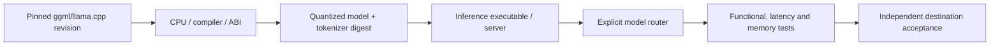

# Fork qualification notes — local CPU inference and model serving

**Scope:** public `llama.cpp` source-evaluation fork. Build/test qualification is distinct from a deployed inference router or a live OpenWebUI cutover.

The owner has explored CPU-oriented inference, AVX-512 qualification, long-running Qwen sampling, service concurrency, model aliases and llama.cpp migration. Such experiments do **not** establish that every application consumer has switched or that a current service is healthy.

A reproducible evaluation records the source SHA, model file digest, quantization, supported CPU instructions, Miniconda/compiler toolchain when relevant, prompt format, tokenizer parity, worker count, context/throughput, cancellation, memory usage, and exact test failures. Negative tests should cover unknown model aliases, incompatible format, server failure and unauthorized cross-project endpoint selection.

Preserve upstream MIT license and all notices. Do not publish private model stores, credentials, local filesystem identifiers, internal service addresses or personal evaluation corpora. `FORK_SOURCE != HOST_BINARY != ACTIVE_ROUTER != USER_ACCEPTED`.
